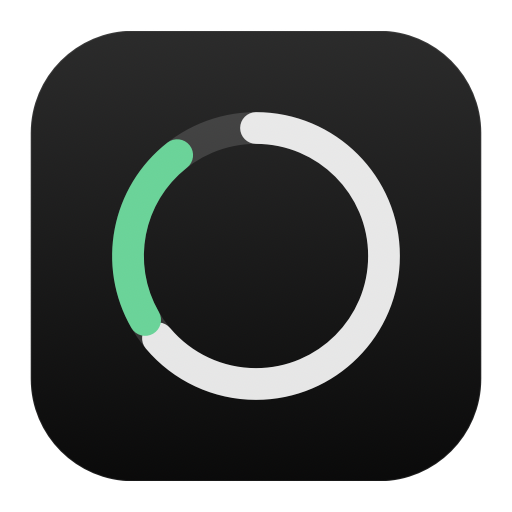

<p align="center">
  
</p>

<h1 align="center">Butler</h1>

<p align="center">
  A quiet helper that lives in your Mac's notch.<br>
  Frees disk space without deleting what matters, keeps your tasks in sync with your iPhone,<br>
  and only speaks up when your Mac is actually in trouble.
</p>

<p align="center">
  macOS 14+ · Native SwiftUI · No accounts · No tracking · MIT
</p>

---

## Why Butler

Most Mac cleaners show a big scary number, then delete things you wanted. Most system monitors alert you about
everything, all the time. Butler tries to do the opposite:

- **It tells the truth about space.** Finder sizes count shared APFS blocks twice. Butler measures what deleting
  something would actually give back.
- **It doesn't nag.** Status sits quietly beside the notch. Alerts appear only when something is really wrong, and then
  go away.
- **It stays on your Mac.** No account, no server, no analytics. Tasks reach your other devices only through Apple
  Reminders and your own iCloud, and only if you switch that on.

## Features

### Storage

Butler scans for space you can get back and sorts it by who owns it:

| | What it is | What Butler does |
|---|---|---|
| **Rebuildable** | Caches, build folders, package caches | Safe to clear. They come back when needed. |
| **Yours** | Large files you put there | Shows them. You decide. |
| **App data** | Chats, media and libraries owned by an app | Explains how to clear it inside that app instead |
| **macOS** | Things the system keeps | Offers only the parts that are safe |

What keeps it accurate:

- **Real sizes.** Each file's private size on APFS is measured, and hard links are counted once. A file that is a
  clone of another frees almost nothing when deleted, so Butler says so. For example, a movie you saved from Telegram
  usually shares its space with Telegram's own copy.
- **Hands off what's in use.** Folders a running process is working in are skipped, such as the project behind a live
  dev server or the app copy Chrome is running from.
- **Protected folders.** Lock any folder or codebase and nothing inside it is ever offered for cleaning.
- **iCloud aware.** Files synced with iCloud are flagged, because deleting them removes them from every device.
- **Trash first.** Items go to the Trash. The few caches that are deleted outright are marked in the list.
- **Low-space warnings and a weekly tidy** of the safe items. Both can be switched off.

### Tasks

- **Plain words.** Type "call Sam tomorrow at 5pm" and Butler adds the task "call Sam", due tomorrow at 17:00.
- **Reminders at the notch.** Answer them right there with Snooze or Done.
- **Sync with Apple Reminders** (optional):
  - Tasks go into your default Reminders list, so they appear on your iPhone, iPad and Watch.
  - Reminders added there show up in Butler.
  - Ticking one off in either place ticks it off everywhere.
- **Calendar** (optional): today's and tomorrow's events sit above your tasks, and the next one shows in the island.
  Butler only reads your calendar.

### Activity

- A small task manager: which apps are using CPU, memory, GPU and energy, with history graphs and a Quit button.
- **Alerts only when it matters:**
  - **CPU:** one app holds a big share of all cores for 5 minutes while the whole Mac is busy.
  - **Battery:** an app drains a battery that is unplugged and at 20% or less.
  - **Memory:** macOS reports critical memory pressure.

  Watching a film or running a build won't trigger them. Each alert shows briefly, then stays quiet about that app for
  hours.
- **Developer mode:** shows local dev servers, services and containers by project and port, with Stop and Force Stop.

### The island

A black island grows out of the notch:

- **Beside the notch:** scan progress, alerts, what's playing and files on the shelf.
- **Open:** pages for storage, tasks, music and a drag-and-drop file shelf.
- **Anywhere:** press **⌥⌘B** to open it.
- **Closing the window** docks Butler into the island. It keeps running there.

Macs without a notch get a virtual one.

## Install

There is no signed download yet, so Butler is built from source. It takes about a minute.

You'll need:

- macOS 14 Sonoma or later.
- Apple's command line tools. Xcode itself is not needed.

```sh
xcode-select --install          # once, if you don't have the tools
git clone https://github.com/BlackChakra/butler.git
cd butler
./scripts/build.sh
open dist/Butler.dmg            # drag Butler to Applications
```

### Keeping permissions across rebuilds

An ad hoc signed app looks like a new app to macOS after every rebuild, so it forgets the permissions you gave it.
To avoid that:

1. Open **Keychain Access**.
2. Choose **Certificate Assistant**, then **Create a Certificate**.
3. Name it `Butler Local Signing` and set the type to **Code Signing**.

`build.sh` signs with that certificate whenever it finds it.

If you distribute your own build, give it its own bundle identifier:

```sh
BUNDLE_ID=com.yourname.butler ./scripts/build.sh
```

## Permissions

Butler asks for each permission the first time you use the feature that needs it. Everything works without the
optional ones; you just see less.

| Permission | Used for | Needed? |
|---|---|---|
| Full Disk Access | Seeing caches inside other apps' Library folders | Optional |
| Reminders | Two-way task sync | Only for sync |
| Calendar | Showing your events. Read only. | Only for Calendar |
| Notifications | Reminders that ring while Butler is closed | Only for timed tasks |
| Automation | Reading what Music, VLC or a browser's YouTube tab is playing, and emptying the Trash through Finder | Only for those |

## Development

```sh
swift build && .build/debug/Butler     # run without bundling (notifications need the .app)
.build/debug/Butler --dump             # run the storage scan in the terminal and print the results
```

The source is grouped by feature:

```
Sources/Butler/
├── App/         Entry point, main window, global hotkey, formatting, debug switches
├── Storage/     Scanner, catalog of cleanable places, cleaner, protected folders, low-space watch, Storage tab
├── Tasks/       Task list, plain-words parser, Reminders and Calendar sync, Tasks tab
├── Activity/    Process and GPU sampling, localhost servers, quitting apps, Activity tab
└── Island/      The notch window, its state and pages, Now Playing, file shelf
scripts/
├── build.sh         Builds Butler.app and Butler.dmg into dist/
└── make_icon.swift  Draws the app icon
```

Environment switches for staging a state without waiting for it, such as a sample alert or a specific page, are listed
in [`App/Debug.swift`](Sources/Butler/App/Debug.swift).

## Contributing

Issues and pull requests are welcome. Anything that changes what Butler offers to delete needs extra care:

- Prefer leaving something out over offering it when unsure.
- Measure what deleting really frees, not what Finder shows.
- Say what happens when an item is removed, in plain words.

If Butler ever suggests deleting something it shouldn't, please open an issue. That is the most useful report there is.

## License

[MIT](LICENSE)
